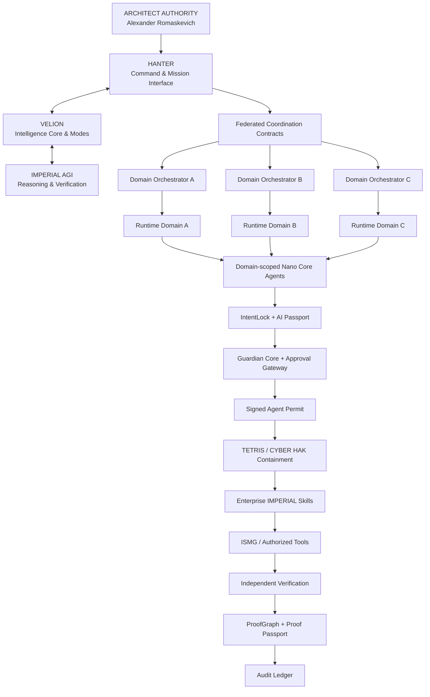
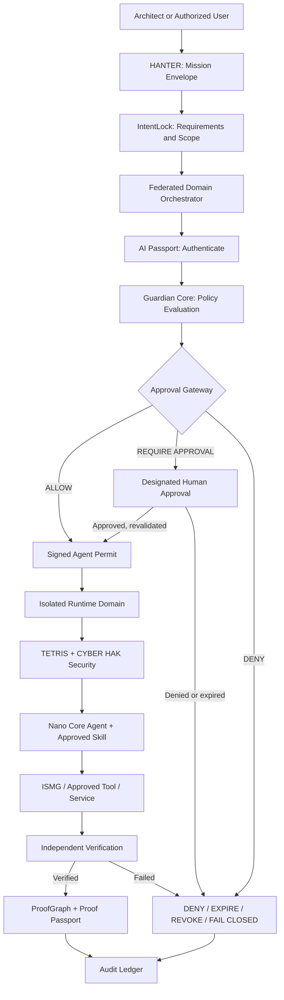

# IMPERIAL CORE — CANONICAL ENTERPRISE ARCHITECTURE BLUEPRINT

**Version:** 1.2 — Proposed architecture (Universal NCA scope)  
**Date:** 2026-10-24  
**Founder / Owner / Architect / Final Architectural Decision Authority:** Alexander Romaskevich (RomaskevicH)  
**Status:** Architecture Before Implementation / Evidence First / Not a Deployment Attestation

> **Scope.** This is a design specification. Component diagrams are conceptual: they do not prove a deployed integration, security certification, production capacity or legal corporate formation. The independent runtime and security properties require actual implementation and verification evidence.

## 1. Non-negotiable principles

- Federated **Multi-Orchestrator Architecture**, with no single global runtime orchestrator.
- **IMPERIAL Core is a digital corporation of Universal Nano Core Agents (NCA)** with a common agent model and dynamically assignable professions, under domain-scoped governance.
- **Founder-led development:** one human, Alexander Romaskevich, using LLM and AI tooling; no fictional human staff.
- **Target population:** 1 → 1,000,000,000 universal NCA identities (architectural capacity objective, not deployed capacity).
- **Identity ≠ Authority · Capability ≠ Approval · Intelligence ≠ Privilege**.
- **Zero Trust · Deny by Default · Fail Closed**.
- AI Passport, Enterprise IMPERIAL Skills, Guardian Core, Approval Gateway, Audit Ledger, Signed Agent Permit, IntentLock and ProofGraph.
- Public/Private Boundary and CRYPTO IMPERIAL Ecosystem Boundary.
- Human Protection Constitution and owner-controlled technical architectural changes.
- E0–E6 evidence ladder; architecture does not imply implementation.

## 2. Enterprise system map



**Design qualification:** Shared boxes represent logical contracts, not a single all-powerful infrastructure instance. The three orchestrators illustrate a federated pattern, not an exact organization count. Cross-domain delegation requires separate permission checks.

## 3. Canonical component tree

```text
IMPERIAL CORE
│
├── 01. ARCHITECT AUTHORITY
│   └── Alexander Romaskevich
│       ├── Founder / Owner / CEO (subject to legal formation and appointment)
│       ├── Architect / Final Architectural Decision Authority
│       └── Final Technical Architectural Decision Authority
│
├── 02. HANTER — Command and coordination, not a global orchestrator
│   ├── Deputy-to-Architect Interface
│   ├── Mission Intelligence / Delegation
│   ├── Federated Coordination Contracts
│   └── Evidence Aggregation
│
├── 03. VELION — Intelligence Core
│   ├── Strategic and long-horizon reasoning
│   ├── Specialized intelligence modes
│   ├── Cognitive support for HANTER
│   └── Recommendations, not execution privilege
│
├── 04. FEDERATED MULTI-ORCHESTRATOR ARCHITECTURE
│   ├── Orchestrator A → Runtime Domain A
│   ├── Orchestrator B → Runtime Domain B
│   ├── Orchestrator C → Runtime Domain C
│   ├── Dynamic domain-orchestrator registration
│   └── No single global orchestrator
│
├── 05. NANO CORE AGENTS / PROFESSIONAL TEAMS
│   ├── Dynamic creation and registration
│   ├── Engineering / Research / Security
│   ├── Business / Financial / Operational
│   └── Domain-specific professional roles
│
├── 06. AI PASSPORT
│   ├── Cryptographic identity / Agent ID
│   ├── Role and runtime-domain binding
│   ├── Scoped capabilities / policy version
│   └── Revocation and trust state
│
├── 07. ENTERPRISE IMPERIAL SKILLS
│   ├── Engineering / Research / Security
│   ├── Infrastructure / Business / Finance
│   └── Versioned specialized capabilities
│
├── 08. INTENTLOCK
│   ├── Mission Envelope integrity
│   ├── Requirement and constraint preservation
│   └── Unauthorized scope-change rejection
│
├── 09. GUARDIAN CORE / APPROVAL GATEWAY
│   ├── Risk and policy assessment
│   ├── ALLOW / DENY / REQUIRE APPROVAL
│   ├── REVOKED / EXPIRED
│   ├── Signed Agent Permit / replay controls
│   └── Zero Trust / Deny by Default / Fail Closed
│
├── 10. RUNTIME DOMAINS
│   ├── Local policy and resource budgets
│   ├── Independent execution boundaries
│   ├── Secret isolation / agent clusters
│   └── Authenticated cross-domain contracts
│
├── 11. IMPERIAL AGI
│   ├── Reasoner / Critic / Verifier
│   └── Evidence-based long-horizon recommendations
│
├── 12. ISMG — IMPERIAL Sovereign Model Gateway
│   ├── Model / Provider / Capability Registries
│   ├── Sovereign routing / Budget control
│   ├── AI Passport validation / Secret Broker
│   └── Audit Adapter / Kill Switch
│
├── 13. TETRIS
│   ├── Security Kernel / Runtime containment
│   ├── Tool and Agent Behavior Firewalls
│   └── Evidence lifecycle / Emergency stop
│
├── 14. CYBER HAK
│   ├── Digital immune system
│   ├── Perimeter / File Forensics / Agent Integrity
│   ├── Runtime Security / Incident Response
│   └── Independent Security QA
│
├── 15. LEGION
│   ├── Independent professional agent ecosystem
│   ├── Distributed participation and coordination
│   └── Runtime-domain isolation
│
├── 16. ORION
│   ├── Independent component / explicit contracts
│   └── No implicit superuser rights
│
├── 17. CONSTRUCTOR AI
│   ├── AI software engineering and application generation
│   ├── Sandbox build, test and QA pipeline
│   └── Proof-carrying release controls
│
├── 18. CAPITAL CORE
│   ├── Economic and business intelligence
│   ├── Capital analysis and risk controls
│   └── Economic analysis ≠ transaction authority
│
├── 19. CRYPTO IMPERIAL ECOSYSTEM BOUNDARY
│   ├── NDB — New Digital Bitcoin
│   ├── IMPERIUM — long-term architectural digital currency
│   │   envisioned for AI agents worldwide
│   ├── MONARCH / NZT / LISA / SALMAN
│   └── BudgetPolicy / PaymentIntent / AuthorizationDecision
│
├── 20. PROOF & EVIDENCE ARCHITECTURE
│   ├── ProofGraph / Proof Passport
│   ├── Audit Ledger / Evidence integrity
│   └── Independent verification and release attestation
│
├── 21. PUBLIC / PRIVATE BOUNDARY
│   ├── Public: approved architecture and verifiable evidence
│   └── Private: proprietary code, secrets, credentials, controls
│
└── 22. HUMAN PROTECTION CONSTITUTION
    ├── Human safety / No deliberate harm
    ├── No coercive manipulation / No repressive use
    ├── No mass-harm use / No weaponization against people
    ├── No governance capture
    └── AI cannot rewrite core protections
```

## 4. Canonical authorized execution chain



**Security invariant:** This is a logical dependency diagram. An implementation must verify authorization **before** executing protected actions and revalidate on policy change, risk change, expiration or revocation. A capability cannot independently bypass Approval Gateway.

## 5. Evidence architecture

| Level | Required evidence | Meaning |
|---|---|---|
| E0 | Architecture | Design documented; not working software |
| E1 | Specification | Integration contracts and acceptance criteria |
| E2 | Implementation | Traceable code or artifacts exist |
| E3 | Static / unit verification | Recorded tests of components |
| E4 | Integration verification | Verified inter-component behavior |
| E5 | Runtime verification | Execution in a designated runtime |
| E6 | Production evidence | Evidence of approved production operation |

**No evidence → no verified claim.** Architecture, implementation, deployment and market performance are distinct.

## 6. Enterprise scalability and federated design

The [Universal NCA digital corporation specification](docs/UNIVERSAL_NCA_CORPORATION.md) defines the shared agent template, dynamic professions and the future architectural target of **1 to 1 billion Universal NCA identities**. One universal agent can assume different permitted roles; no profession is assumed to be inherently supported without evidence.

A reference team may contain five **universal NCA with separately assigned professional roles**, coordinated by one authorized domain orchestrator. A single NCA and other group sizes are equally valid. Founder-led human development presently comprises **one person**, assisted by LLM tools. Registered identities, active agents, concurrent executions and successfully verified tasks must be measured separately. Authorization, admission control, isolation, quotas, scheduling, budgets, revocation and failure containment require benchmarks before any scale claim.

## 7. Proposed corporate boundary

Future corporate arrangements remain private planning. Incorporation and legal appointments require authentic records.

## 8. Crypto and public/private boundaries

Existing code, contracts, domains and private wallets do not automatically transfer to a future corporation. NDB means New Digital Bitcoin. IMPERIUM is a long-term architectural digital currency envisioned for AI agents worldwide; adoption, liquidity and market value are not established here. Exclude credentials, private policy controls and sensitive execution evidence from public materials.


## 9. Acceptance and attribution

Before claiming a module operational, obtain implementation, tests, runtime evidence and authorized review. AI agents cannot independently create legal entities or transfer project assets.

**Architectural attribution:** Alexander Romaskevich (RomaskevicH).  
**Status:** Proposed / Independent verification required.
