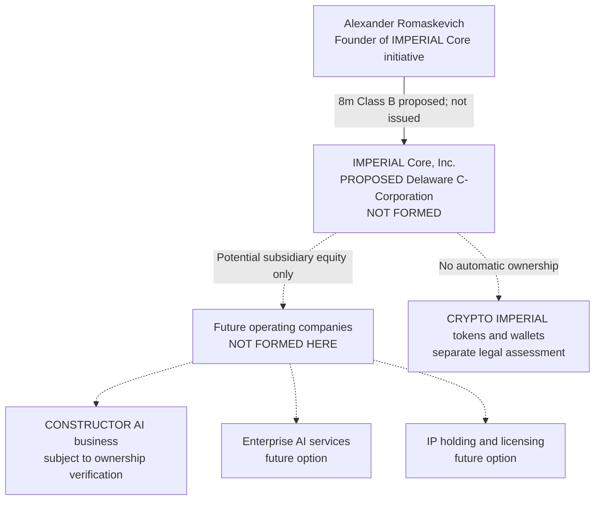

# IMPERIAL Core — Corporate Structure & Subsidiary Blueprint

**Version:** 1.0 · **Date:** 2026-10-24 · **Architect:** Alexander Romaskevich (RomaskevicH)  
**Status:** PROPOSED / LEGAL COUNSEL REVIEW REQUIRED / NO FORMATION OR SHARE ISSUANCE EXECUTED

> IMPERIAL Core, Inc. is a *proposed* Delaware C-Corporation, not a verified incorporated entity. This document is corporate architecture, not a legal filing, IP title opinion or evidence of stock ownership.

## 1. Founder and proposed parent

**Alexander Romaskevich — Александр Николаевич Ромаскевич — RomaskevicH** is the founder and owner of the **IMPERIAL Core architectural initiative** and its Chief Systems Architect. The founder's internal technical decision authority does not supersede directors' fiduciary duties, actual shareholder rights, securities regulation or company law.

A Delaware holding company may eventually hold legally acquired equity in operating subsidiaries, sign licenses and raise capital; today, such ownership must not be presumed.

## 2. Proposed capitalization — exactly 10,000,000 authorized shares

| Class | Authorized | Proposed ordinary votes/share | Proposed founder issuance |
|---|---:|---:|---:|
| Class B Founder Common | 8,000,000 | 10 | 8,000,000, **not yet issued** |
| Class A Common | 2,000,000 | 1 | 0 |
| **Total authorization** | **10,000,000** | — | **No legally executed issuance evidenced** |

One million unissued Class A shares are provisionally earmarked for a future employee plan; another one million remain uncommitted for potential financing. These are planning allocations only. **Ten million shares describes proposed company-wide authorization, not ten million shares currently owned by the founder.**

After valid issuance of 8 million B shares *and no other shares*, the founder would have 100% of then-outstanding shares. If all 2 million A shares were subsequently issued on equal economic terms, the *illustrative* ownership becomes 80% economics and 97.56% ordinary votes; investor preferred rights, class votes, charter amendments and dilution can alter outcomes.

See [full equity/tax memorandum](US_HOLDCO_EQUITY.md).

## 3. Planned legal structure

All dotted connectors are *future possibilities*, not proof of existing entities or control. **HANTER, VELEON, LEGION / NCA, ORION, Guardian Core, CYBER HAK, TETRIS, ISMG, ProofGraph and Audit Ledger are technical roles or components, not legal corporations merely by appearing here.**

## 4. Incorporation and ownership gates

| Gate | Required documentary evidence | Status |
|---|---|---|
| Delaware name/agent | Name clearance, appointed registered agent | Not independently verified |
| Incorporation | State-filed accepted Certificate of Incorporation | Not executed |
| Governance | Incorporator/board consents, bylaws, officer appointments | Not executed |
| Founder equity | Board-approved consideration, exemption review, issuance and stock ledger | Not executed |
| IP transfer | Verified chain of title, signed asset schedules, tax analysis | Not executed |
| Subsidiaries | Country-specific filings and intercompany agreements | Not executed |
| Investor capital | Legally negotiated terms and any necessary charter changes | Not executed |

## 5. Technical and crypto perimeter

**Digital corporation versus legal holding company:** The intended IMPERIAL Core runtime is a founder-led **digital corporation of Universal NCA**, with an architecture goal from **one to one billion universal agents**. The documented human development team is **one person (Alexander Romaskevich), with LLM assistance**. Neither future agents nor model providers are legal staff or shareholders merely by participating in technical work. A billion NCA is a future engineering scale target, not a claim that billion agents already exist; it is also entirely separate from the proposed holding company's **10 million authorized shares**.

See the [Universal NCA specification](UNIVERSAL_NCA_CORPORATION.md).

A *federated runtime domain* is not the same as a legally incorporated subsidiary. Any public/private source, patents, trademarks, software, tokens, accounts, domains or other assets need separately documented legal ownership and authorizations.

**CRYPTO IMPERIAL boundary:** NDB, IMPERIUM, MONARCH, NZT, LISA and SALMAN are separate assets, not automatic corporate equity. IMPERIUM as a digital currency for AI agents worldwide remains a **long-term architecture concept**, not verified worldwide adoption or market liquidity.

All technical operations remain subject to **Identity ≠ Authority, Capability ≠ Approval, Zero Trust, Deny by Default and Fail Closed**. Financial, corporate or securities transactions must be approved by legally empowered humans. AI agents may prepare documents, never independently establish companies, issue shares or transfer treasury assets.

## 6. Attribution and claim standard

The public Git history evidences dated changes to architectural texts, **not** Delaware incorporation, IP title, stock issuance or financial valuation. Upgrade status claims only when authentic underlying records exist.

**Founder:** Alexander Romaskevich (RomaskevicH).  
**Public document status:** Proposal; counsel review required.
