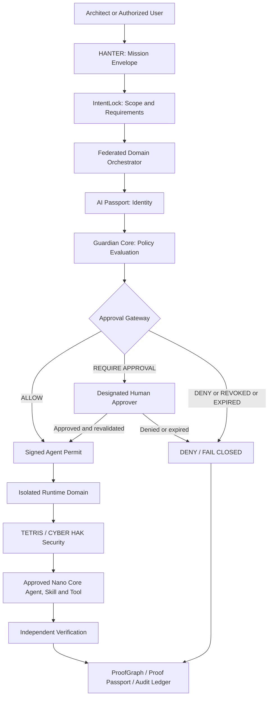

# IMPERIAL CORE — GOVERNANCE AND APPROVAL BOUNDARIES

**Version:** 1.0 (proposed)  
**Date:** 2026-10-24  
**Founder / Technical Architectural Authority:** Alexander Romaskevich (RomaskevicH)  
**Status:** PROPOSED / NOT A RUNTIME ATTESTATION

> **Legal boundary:** Technical governance does not establish incorporation or replace applicable legal obligations.

## 1. Authority structure

| Component | Proposed competence | Explicit limitation |
|---|---|---|
| Architect — Alexander Romaskevich | Final internal technical architectural decisions | Cannot substitute for valid corporate approvals |
| HANTER | Mission interface, planning and federation coordination | No universal orchestrator or implicit superuser |
| VELION / IMPERIAL AGI | Intelligence, analysis and recommendations | Intelligence does not confer authority |
| Domain orchestrators | Local, scope-bound execution | No unauthorized cross-domain access |
| Universal Nano Core Agents (NCA) / LEGION | One general agent architecture, with dynamically assigned professional roles under verified permits | Universal roles do not create unrestricted tools, privileges, legal powers or owner authority |
| AI Passport | Identity, role, policy and domain claims | Identity ≠ Authority |
| IntentLock | Mission scope and requirements integrity | Cannot override authorization policy |
| Enterprise IMPERIAL Skills | Approved, versioned capabilities | Skill availability does not grant execution rights |
| Guardian Core | Risk evaluation and policy enforcement | Default denial for missing or invalid proofs |
| Approval Gateway | ALLOW / DENY / REQUIRE APPROVAL / REVOKED / EXPIRED | Capability ≠ Approval |
| TETRIS / CYBER HAK | Execution security, containment and incident response | Only owned or explicitly authorized systems |
| ProofGraph / Proof Passport | Evidence linking and release attestations | May not manufacture or overstate evidence |
| Audit Ledger | Traceable mission and authorization events | Does not confer decision authority |
| CAPITAL CORE | Economic intelligence and capital analysis | No unilateral payments or treasury movements |

## 2. Action-specific approvals

| Action | Proposed approval gate |
|---|---|
| Read an approved public specification | Domain policy and provenance check |
| Change non-production code | Scoped mission permit and domain engineering review |
| Deploy a production release | Independent QA, security assessment, authorized human approval and release evidence |
| Access secrets or privileged runtime | Scoped agent permit, secret isolation and audit |
| Move corporate funds, cryptocurrencies or create DEX liquidity | Wallet/treasury owner confirmation per transaction; relevant compliance review |
| Transfer intellectual property or form subsidiaries | Lawful owner approval, legal review and executed documentation |
| Cross-domain delegation | Explicit authenticated mission contract, revocable privileges and audit |
| Emergency stop | Authorized kill switch, incident evidence and controlled resumption |

**Never infer owner approval from a model recommendation.** Approval must match the mission, actor, scope, assets, action, risk and expiry time.

## 3. Canonical mission lifecycle

This diagram expresses a **proposed logical control flow**. It does not establish that the sequence is operational. Permissions must be evaluated prior to protected actions and revalidated after relevant changes.

## 4. Federated scalability and isolation

**One-human founder-led development:** Alexander Romaskevich is the sole human contributor represented in this public organizational model; LLM-assisted tools and universal NCA are **software components, not a human workforce**. The [Universal NCA architecture](UNIVERSAL_NCA_CORPORATION.md) targets 1 to 1,000,000,000 agent identities only as a future E0 objective, subject to demonstrated cost, reliability, security, permissions and active-execution capacity.

- A federation may support multiple enterprises, organizations, runtime domains, professional teams and dynamic numbers of Nano Core Agents.
- A reference professional team of five agents with one domain orchestrator is an option, not a universal limit.
- Local orchestrators are autonomous only within approved domain policies and delegated authority.
- Cross-domain communication requires contractual boundaries, authentication, authorization, resource budgets and evidence.
- HANTER coordinates missions without acting as a single global runtime orchestrator.
- Domain admission control, quotas, backpressure and recovery require testing before production-scale claims.

## 5. Security, proof and evidence levels

Every critical action should have a mission identifier, intent hash, AI Passport identity, permit or approval identifier, policy version, execution environment, verification result and accountable audit record. Cryptographic signatures and tamper-resistance require implementation verification.

| Level | Evidence |
|---|---|
| E0 | Architecture and rationale only |
| E1 | Specification and acceptance criteria |
| E2 | Traceable implementation artifacts |
| E3 | Static checks and unit tests |
| E4 | Integration tests |
| E5 | Verified runtime behavior |
| E6 | Approved production evidence |

**No evidence → no verified operational claim.**

## 6. Human protection, corporate and token boundaries

The Human Protection Constitution prohibits deliberate harm, coercive manipulation, repressive use, mass-harm use, weaponization against people and automated revision of core human protections.

The Public / Private Boundary requires approved redaction of sensitive evidence. Do not publish private keys, credentials, production secrets or privileged security controls.

## 7. Change management and release

Updates to this document **do not deploy or activate** controls. Before a production release, require a reviewed architecture contract, explicit integration boundaries, independent security and functional tests, verifiable release evidence, responsible human authorization and rollback or containment provisions.

**Owner / Architectural attribution:** Alexander Romaskevich — RomaskevicH  
**Classification:** Public design specification · Counsel review where corporate matters are involved.
