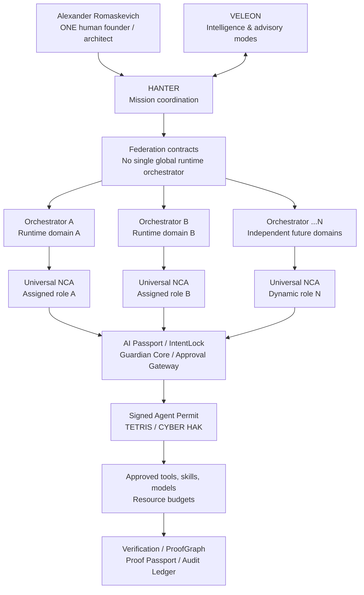

# IMPERIAL Core — Founder-Led Digital Corporation of Universal NCA

**Specification ID:** IC-UNIVERSAL-NCA-001  
**Version:** 1.0 (architecture, proposed)  
**Date:** 2026-10-24  
**Human founder / owner / Architect / Final Architectural Decision Authority:** Alexander Romaskevich (RomaskevicH)  
**Human core team at this documented stage:** **ONE person — the founder**  
**AI-assisted development:** LLM models and approved AI tools, controlled by the founder  
**Status:** E0 DESIGN / NO BILLION-AGENT DEPLOYMENT VERIFIED

> **Canonical definition:** IMPERIAL Core is the envisioned **digital corporation of Universal Nano Core Agents (NCA)**, designed to operate from **1 universal NCA to an architectural upper goal of 1,000,000,000 universal NCA**. This is a target for future design, engineering and validation, **not a statement of current capacity or the number of active agents**.

## 1. Founder-led engineering model

The initiative is being developed by **one human: Alexander Romaskevich**. LLM-based assistants, models and software tools can support his design, coding, verification, documentation and planning. An AI-generated recommendation is not an independent legal or managerial authority, a human employee or proof of implementation.

The founder's internal technical architectural authority is subject to applicable law, actual corporate governance (if and when a company is legally formed), security restrictions and explicit operational approvals.

**“We develop it ourselves”** means the founder-led project authors and controls its product specifications and intended original implementations. It does **not** claim ownership of third-party foundation models, pretrained weights, hosted services, external dependencies or other parties' intellectual property. Provenance, licenses and third-party dependencies must be tracked.

The present **one-human model** is an organizational description, not a commitment to prohibit future contractors, advisers or employees. If a future team exists, document it based on evidence. **Future Nano Core Agents are digital roles, not a human headcount.**

## 2. Universal NCA — common architecture, dynamic professions

A **Universal Nano Core Agent** uses a general agent identity/runtime architecture with the ability to adopt **different approved professional roles**, as required by missions and available capabilities.

- Professional skills are **loaded or assigned per task**, via audited Enterprise IMPERIAL Skill manifests.
- A task requires appropriate model quality, tools, data access and domain-specific validation; no agent is presumed qualified for every profession.
- Roles such as **Coder**, **Researcher**, **Analyst**, **Security Reviewer**, **Designer**, **Tester** and **Business Operator** are configurations of the **same universal NCA framework**, not immutable agent species.
- A team may use **five Universal NCA + one domain orchestrator** as a reference pattern, but **a single NCA, another team size or multiple independent orchestrators are equally valid**.
- An agent may change roles only under task-specific permissions, resource limits, lifecycle checks and traceable evidence.
- **Universal does not mean unlimited authority, competence or automatic autonomy.**

## 3. Scalability goal — from 1 to 1,000,000,000 NCA

| Milestone | Universal NCA population (target) | Evidence required |
|---|---:|---|
| M0 — Single agent | 1 | Real authorized task, secure tool call, verifiable trace |
| M1 — Professional team | 2–10 | Role assignment, team coordination, independent QA |
| M2 — Local workforce | 11–1,000 | Reliable queues, budgets, cancellations, policy enforcement |
| M3 — Federated enterprise | 1,001–1,000,000 | Domain isolation, sharding, disaster recovery, load tests |
| M4 — Planetary federation research | 1,000,001–1,000,000,000 | Benchmarked architecture, economic feasibility, security and governance at scale |

**These are capacity planning milestones, not achievements.** Distinguish the number of **identities registered**, **agents permitted**, **agents active**, **agents concurrently executing**, **tasks completed** and **productive agents**. An agent identity does not require a continuously running LLM instance, and one billion identities do **not** imply one billion simultaneous inference calls.

## 4. Federated runtime architecture

**Interpretation:** Diagrams show **proposed logical contracts**, not an operating software deployment. Repeated shared components denote interfaces and scoped services; they do **not** mean a global executor with universal privileges.

## 5. Proposed agent identity contract

| Field | Meaning |
|---|---|
| `agent_id` | Distinct agent identity; collision resistance and revocation |
| `domain_id` | Authorized runtime and tenant boundary |
| `passport_id` | Signed or otherwise verifiable AI Passport |
| `mission_id` | Owner-authorized mission and IntentLock reference |
| `role_profile` | Current mission-specific profession |
| `approved_skill_manifest` | Reviewed, versioned and allowlisted skill packages |
| `model_policy` | Model/LLM and provider restrictions; data handling and budget |
| `signed_agent_permit` | Short-lived scoped tool/action authorization |
| `limits` | Resource quotas, timeouts, rate limits and cancellation |
| `proof_ref` | Verification artifacts and Audit Ledger linkage |
| `lifecycle` | Requested → Registered → Authorized → Active → Suspended / Revoked / Archived |

**Security invariant:** Identity ≠ Authority; Capability ≠ Approval; Intelligence ≠ Privilege. Provisioning and registering an agent is not permission to activate it or use tools.

## 6. Engineering gates for massive scale

- **Identity:** scalable sharded registries and validated cryptographic credentials.
- **Federation:** explicit cross-domain contracts; independently revocable delegated permissions.
- **Runtime:** domain-local queuing, admission control, backpressure, fault isolation, retries with budgets and safe shutdown.
- **Economics:** measured LLM inference, context, storage, infrastructure and third-party API costs. **FREE_ONLY** is a development policy and cannot be guaranteed at planetary scale.
- **Quality:** evidence-backed test suites, independent acceptance and task-specific evaluation.
- **Security:** Guardian Core, Approval Gateway, TETRIS, CYBER HAK and Human Protection Constitution.
- **Provenance:** source licensing, third-party API/model declarations and signed releases.
- **Observability:** distinguish queued, registered, active, failed, revoked and completed tasks, with per-domain SLOs.
- **Safety:** no unsupervised creation of agents with escalating authority; no uncontrolled self-replication, payment initiation or access to secrets.
- **Attestation:** E0 (architecture) → E1 (specification) → E2 (implementation) → E3 (unit) → E4 (integration) → E5 (runtime) → E6 (production). Do not claim stages without independent evidence.

## 7. Company, token and ownership boundaries

The phrase **digital corporation** describes the planned operational network of Universal NCA. It **does not prove formation of a legal corporation**. The proposed Delaware holding company **IMPERIAL Core, Inc.** is distinct and requires actual incorporation, corporate approvals and valid securities issuance. Its proposed **10,000,000 authorized corporate shares** are **not** the **1,000,000,000-agent target**. The contemplated founder issuance is **8,000,000 Class B shares**, not executed.

**CRYPTO IMPERIAL** tokens are neither corporate shares nor automatic shares in a Universal NCA workforce. AI agents do not autonomously issue securities, acquire legal ownership of assets or move treasury funds.

## 8. Founder attribution and public statement

**Founder:** Alexander Romaskevich · Александр Николаевич Ромаскевич · RomaskevicH  
**Project:** IMPERIAL Core — founder-led digital corporation architecture for Universal Nano Core Agents  
**Human founding team:** one person (the founder), supported by LLM-based tools  
**Universal NCA scale target:** from **1** to **1,000,000,000** identities (future objective, unverified at scale)  
**Intelligence component:** **VELEON** (other labels may describe modes, not the canonical product name)

**Release gate:** No Evidence → No Verified Claim.
